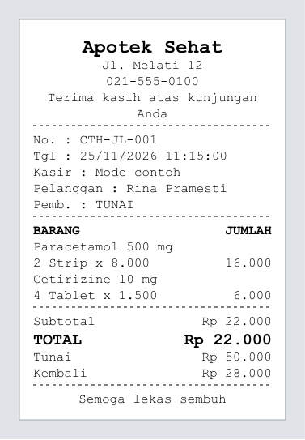
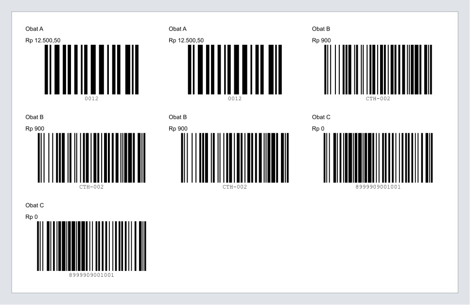

# Pemetaan referensi desktop iB Apotek

Sumber: sepuluh gambar yang diberikan pengguna di `/home/ardiand/Downloads/IB`. Seluruh gambar sudah diperiksa secara visual pada ukuran aslinya. Salinan tersedia di [references/ib](references/ib). Gambar 1–9 menampilkan iB Apotek 5 Solution 5.2; gambar 10 menampilkan 5.2.761.

Referensi ini melengkapi [referensi video](video-reference.md). Hasil pemeriksaan transaksi, perbaikan identitas apotek, dan batas produksi tersedia pada [audit POS](pos-audit.md). Pilihan proyek tetap desktop Windows, antarmuka bersih dan ringan, database LAN, dan cadangan lokal. Perilaku fitur menjadi acuan; warna, ikon, bingkai, dan penumpukan jendela tidak perlu ditiru.

## Status penyesuaian, 26 November 2026

Lima tahap penyesuaian di bawah sudah diterapkan. Tabel temuan awal tetap disimpan sebagai catatan audit; kolom perbandingannya menggambarkan keadaan sebelum penyesuaian ini.

| Referensi | Perilaku yang tersedia sekarang |
| --- | --- |
| 1 — Master obat | Filter nama/barcode, kategori, suplier, satuan beli, stok, dan ED; navigasi 100 obat per halaman; nomor baris, harga dan satuan beli, suplier, ED terdekat, serta kolom batch melalui gulir horizontal. Harga beli master disimpan per satuan dasar dan ditampilkan sesuai konversi satuan beli. |
| 2 — Suplier | Kode, nama, alamat, telepon, email, rekening, keterangan, serta impor/ekspor Excel. Kode suplier harus unik. Master Sales tersedia terpisah dari operator. |
| 3 — Impor obat | Unduh template Excel, pilih berkas, progres persen, dan jumlah baris. Penyimpanan berlangsung dalam transaksi database pada thread terpisah; bila gagal, seluruh impor dibatalkan. Impor obat mencakup master, satuan beli, dan konversi, tetapi belum memulihkan stok/batch historis atau relasi suplier. |
| 4 — Daftar penjualan | F1 membuka penjualan baru. Filter tanggal/pencarian; operator, pelanggan, dan pembayaran tersedia lewat Filter tambahan. Kolom waktu, pembayaran, jatuh tempo, Sales, laba, dan operator; rincian obat per faktur, serta menu cetak/ekspor. Dokter tidak ditampilkan. |
| 5 — Input penjualan | F1 membuka pemilih obat dari master dengan pencarian, stok, dan ED. Pemilih memakai Enter, panah, dan Tab; Esc kembali ke input scanner. Baris kode/nama/jumlah/satuan/harga/diskon langsung di atas keranjang tetap tersedia. Scan + Enter menambah satu satuan dasar dan scan berulang menaikkan jumlah. Tanggal, faktur otomatis, pembayaran, Sales, dan pelanggan tampil di atas. Baris input dan keranjang memakai lebar penuh. Diskon faktur persen/nominal, ongkos, total, bayar, kembalian, dan pilihan kertas 58/80 mm tampil langsung di bawah. F2 memilih nominal Bayar; Enter pada Bayar atau F3 menyimpan dan membuka pertanyaan cetak struk. Dokter tidak ditampilkan. ED dan batch tetap dicatat saat stok masuk. |
| 6 — Detail dan struk | Pratinjau struk berada di dalam aplikasi. Faktur tersimpan dapat dipratinjau dan dicetak ulang dari riwayat. Nama pelanggan/operator, diskon, ongkos, total, dan status retur ditampilkan. Simpan penjualan diikuti pertanyaan Ya/Tidak cetak; tombol dan shortcut cetak F4 pada kasir dihapus. Cetak ulang memakai faktur tersimpan tanpa menyimpan transaksi atau mengurangi stok lagi. |
| 7 — Laporan per barang | Rincian faktur dikelompokkan per kode obat dengan jumlah, satuan, harga, penjualan neto, laba, pelanggan, dan total kelompok. Diskon faktur dialokasikan menurut subtotal barang; ongkos masuk laba faktur, bukan laba per barang. Faktur yang diretur tidak masuk laporan ini. |
| 8 — Barcode | Tambah obat membuka pemilih dengan Ctrl/Shift atau Pilih semua hasil pencarian. Jumlah per obat, hapus, kosongkan daftar, ukuran/kolom label, dan DPI 203/300 tersedia. Lihat label membuka lembar putih dalam aplikasi dengan zoom 75–200%; tombol Cetak memakai dialog printer native. Ekspor HTML barcode dihapus. |
| 9 — Menu baris obat | Shift memilih rentang baris; Ctrl menambah/membatalkan baris terpisah. Klik kanan mempertahankan pilihan bila baris yang diklik termasuk pilihan tersebut. Menu menyediakan edit, nonaktifkan, refresh, kartu stok, barcode, stok opname, isi barcode kemasan, dan batch/ED. Barcode dan nonaktifkan memakai daftar obat yang benar-benar dipilih. |
| 10 — Grafik bulanan | Pilih bulan `YYYY-MM` untuk grafik harian omzet dan laba, total bulan, serta pratinjau/cetak melalui browser. Grafik juga menampilkan laba negatif. |

Antarmuka memakai tema FLTK terang yang sama pada kasir, master, dan dialog. Navigasi kemudian diubah menjadi sidebar sesuai permintaan pengguna: kelompok menu dapat dibuka-tutup, halaman aktif ditandai, dan akun berada di bawah. Tangkapan layar hasil penyesuaian tersedia di [referensi video](video-reference.md#pratinjau).

### Label barcode massal

Gambar 8 memperlihatkan beberapa kode obat pada satu lembar dengan tiga kolom. Buka **Cetak barcode** di master obat atau menu klik kanan. Gunakan **Tambah obat**, cari nama/kode lalu tekan Enter, dan pilih dengan Ctrl/Shift atau **Pilih semua** hasil yang tampil. Pilihan yang sudah ada di antrean tidak ditambahkan ulang. Pada antrean, klik biasa mengganti pilihan, Shift memilih rentang dari titik awal klik, dan Ctrl menambah/membatalkan baris terpisah. **Ubah jumlah pilihan** menerapkan **Jumlah label** hanya pada baris yang dipilih; **Hapus dari daftar** mengikuti pilihan yang sama. Penambahan obat mempertahankan pilihan, sedangkan penggantian susunan daftar mereset pilihan dan titik awal Shift.

Alur utama hanya **Lihat label**, lalu **Cetak** pada pratinjau. Semua label tampil pada lembar putih berbingkai di atas latar abu-abu, dengan gulir untuk antrean panjang. Pilih zoom 75%, 100%, 125%, 150%, atau 200%; default 150%. Zoom hanya mengubah tampilan. Nama dan harga rata kiri, barcode berada di bawahnya, serta kode terbaca di tengah. Label dicetak sebagai vektor pada ukuran sebenarnya dan dibagi ke halaman tanpa memotong baris label. Pilih kertas yang memuat semua kolom; tiga kolom label 50 mm dengan jarak 2 mm membutuhkan area cetak 154 mm. Kertas terlalu sempit ditolak tanpa mengecilkan barcode. **Kosongkan daftar** menghapus antrean label. Harga desimal dan nol di awal kode dipertahankan. Barcode tidak menyediakan ekspor/cetak HTML.

Struk memakai susunan nota thermal: identitas di tengah, nomor/tanggal/kasir/pelanggan/pembayaran, nama barang diikuti jumlah × harga dan nominal rata kanan, garis putus-putus, TOTAL tebal, tunai/kembali atau kredit/sisa, dan catatan penutup. Diskon/ongkos nol disembunyikan. Pratinjau dan ESC/POS mengambil isi dari pembentuk baris struk yang sama, termasuk diskon barang, tanggal lokal yang diformat, pecahan rupiah, dan kredit/retur.

Contoh berikut dibangkitkan dari data layout pratinjau dengan data uji. Gambar ini membantu meninjau susunan dokumen; pemeriksaan GUI dan printer tetap tercatat terpisah.

Toolbar master obat disederhanakan menjadi **Tambah obat**, **Cetak barcode**, dan **Lainnya**. Edit, nonaktifkan, muat ulang, serta impor/ekspor Excel tetap tersedia di menu Lainnya. Navigasi halaman berada di kanan dan tombol sebelumnya/berikutnya dinonaktifkan ketika tidak ada halaman tujuan.

Perubahan 25 November diverifikasi dengan build offline dan 16 uji unit. Uji layout native mencakup isi struk, teks panjang, pecahan rupiah, kredit/retur, serta pembagian 1.000 label ke halaman tanpa kehilangan label. Uji ESC/POS memastikan baris panjang tetap muat pada 32/48 kolom dan nominal rata kanan. Pembaca barcode independen memverifikasi 11 kode, tiga preset ukuran/DPI, serta enam vektor label dari tiga obat. Uji interaksi GUI terbaru telah diperbarui tetapi belum dijalankan karena eksekusi Xvfb sebelumnya ditolak automatic approval review. Screenshot barcode lama belum menggambarkan pemilih dan pratinjau baru; dialog printer dan hasil cetak vektor masih perlu diperiksa pada perangkat target.

### Alur pending dan cetak

Tambahan kebutuhan pengguna pada Pengaturan menyediakan **Akun karyawan → Tambah akun** menggunakan pengelolaan akun Operator yang sama. Hak akses dan status dipilih dari daftar. Pengelolaan akun hanya untuk admin. Header/footer struk menggunakan input beberapa baris dengan Enter, termasuk baris kosong, sehingga pengguna tidak mengetik `^J` atau markup.

Gambar 5 memperlihatkan Simpan F3, Cetak F4, Pending F6, dan Daftar Pending F7 dalam kasir yang sama. Gambar 6 memperlihatkan pratinjau struk untuk faktur tersimpan. Sesuai kebutuhan pengguna terbaru, proyek memakai pertanyaan cetak setelah simpan dan menghapus tombol serta shortcut cetak F4. Gambar tidak membuktikan urutan internal cetak dan penyimpanan iB; proyek menyimpan transaksi terlebih dahulu agar struk final merujuk faktur dan stok yang sudah tercatat.

- Dari daftar **Penjualan**, **F1** membuka penjualan baru. Di kasir, **F1** membuka pemilih obat dari master. Ketik nama/barcode lalu **Enter** untuk mencari, gunakan **panah atas/bawah** memilih obat, **Enter** menuju jumlah, lalu **Enter** menambah obat. Satuan terkunci mengikuti master; **Tab** berpindah ke harga/diskon. Stok dan ED ditampilkan tanpa meminta input batch atau ED penjualan.
- Scanner tetap langsung menambah satu satuan dasar lewat barcode + Enter. **Esc** menutup pemilih dan kembali ke input scanner. Selesai menambah obat, fokus kembali ke barcode. Setelah transaksi tersimpan dan cetak selesai atau memilih Tidak, aplikasi otomatis kembali ke riwayat penjualan; **F1** membuka transaksi berikutnya.
- **F2** memfokuskan Bayar dan memilih seluruh nominal lama sehingga kasir dapat langsung mengetik nominal baru. **Enter** pada Bayar atau **F3** menyimpan penjualan. Setelah berhasil, pertanyaan **Ya/Tidak** cetak tampil: **Enter** memilih cetak, **Esc** melewati cetak, atau gunakan **Tab/Space** untuk memilih tombol. Penyimpanan faktur, mutasi stok, dan penghapusan pending terjadi dalam satu transaksi database sebelum cetak.
- Isi keranjang, lalu **F6** menyimpan draf dan mengosongkan kasir untuk transaksi berikutnya. Pembayaran tunai belum harus lunas dan stok belum berkurang.
- **F7** membuka kembali draf. Menyimpan pending dengan faktur/operator yang sama memperbarui draf, termasuk bila dua client melakukannya bersamaan. Untuk pembelian, suplier juga menjadi bagian identitas draf.
- Pending lama dengan faktur sama ditampilkan sekali, memakai versi terakhir. Versi lama tidak dihapus saat membaca daftar; semua versi untuk faktur tersebut dikonsumsi ketika transaksi berhasil disimpan.
- Jika cetak gagal atau dibatalkan setelah penyimpanan, faktur tetap tersimpan. Cetak ulang dari riwayat penjualan memakai faktur yang sama tanpa transaksi atau pengurangan stok baru. Memulai transaksi baru lewat F5 atau menambah obat memulai keranjang berikutnya.
- Pratinjau struk di riwayat memakai jendela native di aplikasi. Windows dengan printer yang dikonfigurasi memakai ESC/POS. Pada platform lain atau tanpa nama printer, cetak memakai dialog printer native. Memilih Tidak pada pertanyaan cetak hanya melewati pencetakan; transaksi tetap tersimpan.

Perbarui aplikasi pada semua PC LAN agar seluruh client memakai alur pending yang sama. Tidak ada penambahan skema untuk perbaikan alur ini.

### Upgrade dan pemeriksaan

Jalankan versi baru pada **komputer server terlebih dahulu**, lalu perbarui dan jalankan client. Server menambahkan kolom satuan beli, metadata suplier, Sales, ongkos, dan snapshot nama/kode obat melalui migrasi. Suplier lama tanpa kode mendapat kode `SUP-{id}`. Data dan pengaturan yang sudah ada tidak diisi ulang oleh migrasi.

Build offline dan sepuluh uji unit lulus. Uji MariaDB sementara mencakup upgrade skema lama, FEFO, diskon/ongkos, Sales/dokter, pemuatan faktur tersimpan, filter dan navigasi master, impor atomik, serta pemulihan cadangan, pending bersamaan/upsert, pending tanpa pembayaran, konsumsi pending saat checkout, serta cetak gagal/ulang tanpa faktur atau mutasi stok ganda. Uji GUI mencakup scan berulang, input langsung, total/kembalian, pilihan beberapa baris, label beberapa obat, menu baris, struk, dan grafik. Uji regresi tabel memastikan header, kolom, dan scrollbar tetap terlihat. Uji sidebar memeriksa seluruh halaman, menu yang dibuka-tutup, penanda aktif, serta akun pada layar lebih pendek. Pembaca barcode independen memverifikasi sebelas kode dan tiga kombinasi ukuran/DPI.

Perintah lengkap tersedia di [pemeriksaan aplikasi](video-reference.md#pemeriksaan). Pengujian menggunakan Linux dan database sementara; database apotek asli tidak dipakai untuk pengujian.

### Batas dan bagian referensi yang belum diketahui

- Antrean barcode dibatasi 200 obat dan 1.000 label per dokumen. Pilih DPI sesuai printer. Label kecil ditolak jika batang barcode terlalu sempit untuk ukuran dan DPI yang dipilih.
- Laporan per barang memuat paling banyak 10.000 rincian; laporan lain 500 baris. Persempit periode atau pencarian jika mencapai batas.
- Impor obat hanya menambah master baru secara atomik. Template memakai harga beli/jual **per satuan dasar**; relasi suplier dan stok/batch historis belum diimpor.
- Retur tetap satu faktur utuh. Makna `Nhari`, jenis penjualan selain `Biasa`, rincian Biaya/Cashflow, dan aturan penghapusan transaksi belum dapat dipastikan dari gambar. Modul dan perilaku keuangan tersebut belum ditambahkan.
- Windows, scanner/printer fisik, dan koneksi dua komputer LAN masih perlu diuji pada perangkat target.

Penyesuaian kebutuhan pengguna menghilangkan dokter dari antarmuka, meskipun fitur tersebut terlihat pada gambar iB. Data dokter pada database dan metadata pending lama dipertahankan. Kasir terbaru mengikuti gambar yang dikirim pengguna: metadata di atas, input obat satu baris, keranjang lebar, dan diskon/pembayaran di bawah. Filter laporan tetap disembunyikan secara default; cetak/ekspor digabung dalam satu menu. Build dan sepuluh uji unit lulus; uji GUI ulang setelah perubahan terakhir tertahan oleh automatic approval review. Rincian pemeriksaan tersedia pada referensi video.

## Temuan awal per gambar

| Gambar | Fitur yang terlihat | Perbandingan dengan proyek saat diperiksa |
| --- | --- | --- |
| [1 — Master obat](references/ib/aplikasi-apotek-5.2-1.png) | Kode, nama, kategori, stok, harga/satuan beli, harga/satuan jual, suplier, dan tanggal ED. Filter kategori, suplier, satuan beli, stok, dan ED. Pencarian, tambah/edit/hapus, impor/ekspor, dan halaman 1/17 untuk 1.611 obat. | CRUD, satuan, stok, harga, ED, pencarian, dan impor/ekspor tersedia. Filter kategori/suplier/satuan beli, metadata satuan beli tersendiri, kolom suplier, dan navigasi halaman belum tersedia. Hasil pencarian sekarang dibatasi 200 obat. |
| [2 — Suplier](references/ib/aplikasi-apotek-5.2-2.png) | Kode suplier, nama, alamat, nomor telepon, email, rekening, dan keterangan. Daftar menyediakan impor/ekspor. | Nama, telepon, alamat, dan CRUD tersedia. Kode, email, rekening, keterangan, serta impor/ekspor suplier belum tersedia. |
| [3 — Impor obat](references/ib/aplikasi-apotek-5.2-3.png) | Unduh format Excel, pilih berkas, tombol impor, jumlah baris yang diproses, serta progres persen. | Impor/ekspor master Excel tersedia dan impor disimpan secara atomik. Dialog unduh template dan progres belum tersedia. Impor sekarang tidak memuat stok/batch historis. Struktur kolom template referensi tidak terlihat dalam gambar. |
| [4 — Daftar penjualan](references/ib/aplikasi-apotek-5.2-4.png) | Filter tanggal, operator, pelanggan, dokter, dan tunai/kredit. Tabel faktur, tanggal/waktu, pembayaran, Nhari, jatuh tempo, pasien, dokter, total, bayar, laba, dan operator. Tombol tambah, detail, hapus, retur, cetak, dan ekspor. Menu transaksi juga memuat Biaya dan Cashflow. | Daftar, tanggal, pencarian, rincian obat, retur, pembayaran kredit, dan ekspor tersedia. Filter pilihan operator/pelanggan/dokter/pembayaran, kolom waktu/jatuh tempo/dokter/laba/operator, dan cetak daftar belum lengkap. Modul Biaya dan Cashflow belum tersedia. Makna Nhari dan isi kedua modul tersebut tidak dapat dipastikan dari gambar ini. |
| [5 — Input penjualan](references/ib/aplikasi-apotek-5.2-5.png) | Tanggal, faktur otomatis, pembayaran, jenis penjualan Biasa, Sales, dan pelanggan. Satu baris kode/F1, nama, jumlah, satuan, harga, diskon persen, dan total berada langsung di atas keranjang. Diskon faktur persen/nominal, ongkos, total, bayar/F2, kembalian, F3–F7, serta pilihan struk 58 mm. Tidak ada input ED atau batch pada penjualan. | Scan lengkap langsung menambah satu satuan dasar dan scan ulang menaikkan jumlah. Data dan harga diambil dari master, stok diperiksa, serta F1–F7, pending, tunai/kredit, dan struk tersedia. Input manual masih berupa dialog; baris input langsung, Sales, jenis penjualan, tanggal yang dapat dipilih, diskon faktur, ongkos, dan pilihan kertas pada kasir belum tersedia. |
| [6 — Detail dan struk](references/ib/aplikasi-apotek-5.2-6.png) | Detail penjualan yang sudah tersimpan dan pratinjau struk sebelum cetak. Struk memuat identitas apotek, tanggal, faktur, pelanggan, pembayaran, obat, harga, jumlah, diskon, total, tunai, kembalian, operator, dan footer. | Rincian faktur dan struk RAW ESC/POS tersedia. Pratinjau struk dan cetak ulang langsung dari riwayat faktur belum tersedia. |
| [7 — Laporan penjualan per barang](references/ib/aplikasi-apotek-5.2-7.png) | Laporan cetak dikelompokkan per obat. Setiap kelompok berisi faktur, tanggal, harga, jumlah, satuan, total, laba, dan pelanggan, dengan total per kelompok serta periode laporan. | Laporan obat terlaris menyediakan jumlah dasar dan omzet agregat. Laporan rincian faktur yang dikelompokkan per obat, laba per kelompok, dan pratinjau cetaknya belum tersedia. |
| [8 — Pembuatan barcode](references/ib/aplikasi-apotek-5.2-8.png) | Daftar beberapa obat, harga, ukuran label dengan pilihan terlihat `30x20mm 3`, jumlah, reset, delete, preview, dan cetak. Hasil menampilkan beberapa kode obat dalam satu lembar, masing-masing dengan nama, harga, barcode, dan kode. | Barcode dapat diisi atau dibuat untuk obat, dipratinjau, disimpan, dan dicetak. Cetak sekarang hanya untuk satu obat per dialog; ukuran mengikuti panjang kode dengan minimum 50 × 30 mm, dan label belum menampilkan harga. Antrean beberapa obat, pilihan ukuran/kolom, serta harga pada label belum tersedia. Jumlah salinan persis dari opsi `Jumlah` tidak dapat disimpulkan hanya dari satu tangkapan layar. |
| [9 — Menu klik kanan](references/ib/aplikasi-apotek-5.2-9.png) | Beberapa baris diseleksi. Menu memuat Edit, Delete, Refresh, Kartu Stok, Barcode, dan Stok Opname. | Menu klik kanan sekarang memuat isi barcode, buat barcode, batch/ED, dan edit. Refresh, nonaktifkan, kartu stok, dan stok opname tersedia melalui kontrol atau halaman lain, tetapi belum semuanya tersedia dari menu baris obat. Cetak barcode belum memakai pilihan beberapa baris. |
| [10 — Grafik omzet dan laba](references/ib/aplikasi-apotek-5.2-10.png) | Laporan grafik harian untuk bulan/tahun tertentu, dua seri omzet/laba, total keduanya, identitas apotek, dan pratinjau cetak. Latar master obat juga memperlihatkan kolom nomor batch. | Dashboard menampilkan grafik omzet 30 hari dan ringkasan laba; laporan harian menyimpan omzet dan laba. Grafik dua seri untuk bulan yang dipilih serta hasil cetaknya belum tersedia. Nomor batch tersedia melalui rincian batch, bukan kolom utama obat. |

## Alur yang harus dijaga

1. Master obat menyimpan identitas, barcode/kode, harga, satuan, serta informasi batch. Pembelian mencatat stok masuk, batch, dan ED. Penjualan memakai data yang sudah ada.
2. F1 di daftar penjualan membuka kasir; F1 di kasir membuka pemilih obat dari master yang dapat dioperasikan melalui Enter, panah, Tab, dan Esc. Barcode yang cocok memuat obat dan harga dari master, langsung menambah satu satuan dasar, dan scan berulang menambah jumlah. Input manual dapat mengatur jumlah, harga, dan diskon dalam baris di atas keranjang. Sesuai kebutuhan pengguna, satuan hanya diubah di master dan ditampilkan terkunci saat input transaksi. Penjualan memakai satuan dasar; pembelian memakai satuan beli. F2 memilih nilai Bayar; Enter pada Bayar atau F3 menyimpan sebelum pertanyaan cetak tampil.
3. Pemilihan satuan harus memakai konversi yang tersimpan. Total keranjang diperiksa terhadap stok layak jual. Simpan penjualan mengurangi stok sesuai FEFO; barcode dan pratinjau tidak mengubah stok.
4. Menu klik kanan harus bekerja pada baris yang diklik. Aksi barcode perlu mendukung beberapa obat yang dipilih. Kartu stok dan stok opname perlu dapat dibuka untuk obat tersebut tanpa mencari ulang.
5. Barcode pada gambar memakai kode obat yang sudah ada, misalnya `AK0209`. Membuat gambar barcode dari kode tersimpan tidak perlu mengganti identitas obat. Pilihan ukuran cetak harus tetap menghasilkan barcode yang dapat dibaca scanner.
6. ED harus tampil sebagai tanggal. Beberapa batch dapat mempunyai tanggal berbeda; kolom ringkasan perlu diberi nama ED terdekat dan rincian tetap memperlihatkan semua batch yang mempunyai stok.

## Urutan penyesuaian berdasarkan perbedaan

1. Baris input penjualan langsung dan pengaturan jumlah/satuan/harga/diskon tanpa dialog tambahan.
2. Barcode beberapa obat sekaligus, ukuran label, jumlah, nama/harga, dan pratinjau cetak.
3. Menu baris obat untuk kartu stok, stok opname, refresh, dan nonaktifkan; lengkapi filter dan halaman master obat.
4. Lengkapi data suplier, template/progres impor, filter dan metadata daftar penjualan.
5. Pratinjau/cetak ulang struk, laporan per barang dengan laba, dan grafik omzet/laba per bulan.

Nama master **Sales** terlihat terpisah dari **Karyawan** dan pilihan Sales juga ada pada penjualan. Ini menunjukkan keduanya tidak boleh langsung dianggap sebagai data yang sama. Isi master Sales, pilihan jenis penjualan selain Biasa, serta rincian Biaya/Cashflow tidak terlihat; aturan yang belum ditunjukkan perlu dicatat sebagai belum diketahui.

Bagian temuan awal dan urutan penyesuaian mencatat hasil audit sebelum implementasi. Status implementasi terbaru dan batas pengujian tercantum pada bagian awal dokumen ini.
