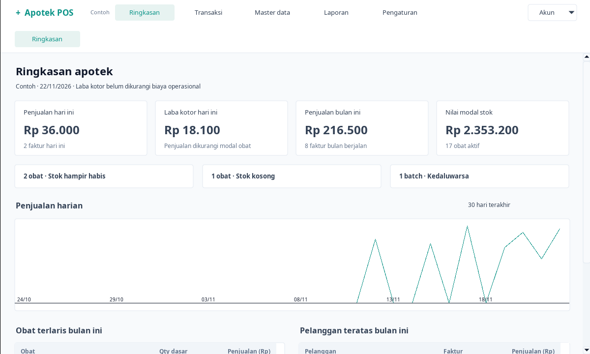
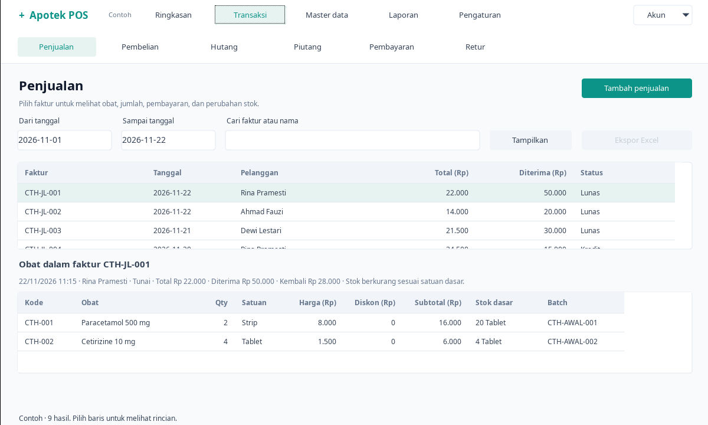
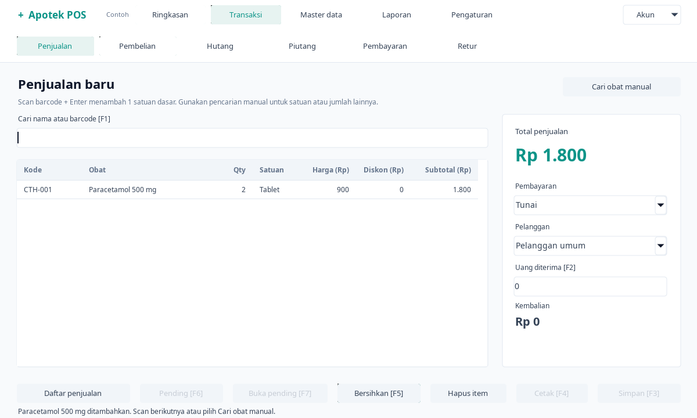
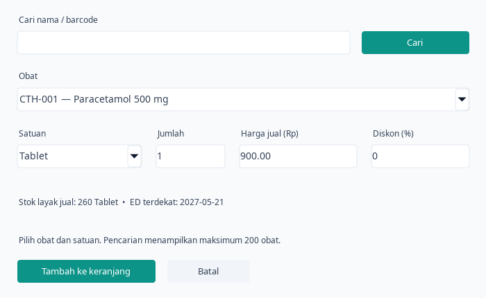
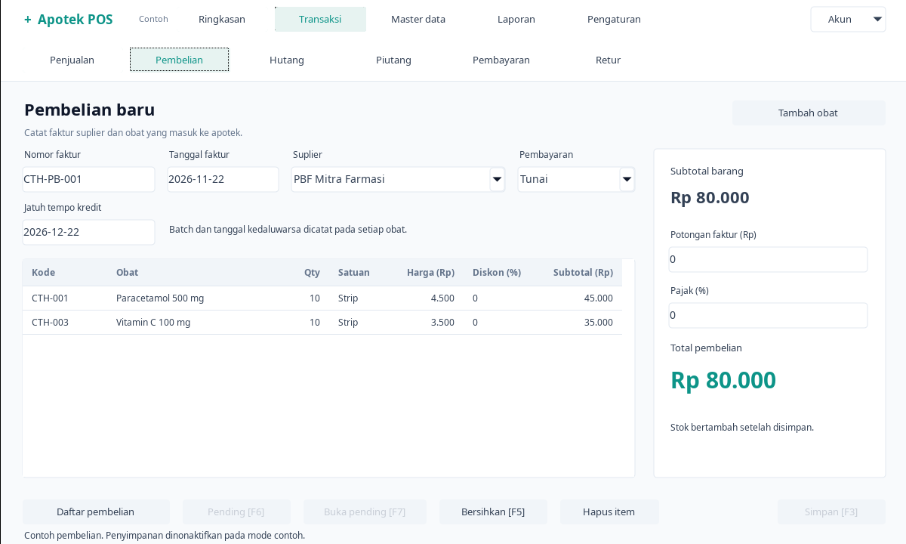
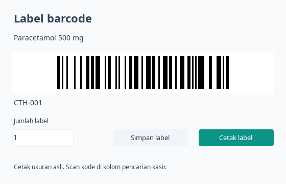

# Adaptasi referensi video ke desktop Windows

Referensi: https://www.youtube.com/watch?v=LvgDavrJEz0 — “Test Upload”, durasi 1 menit 57 detik.

Sepuluh tangkapan layar desktop iB Apotek dari pengguna juga sudah diperiksa. Rincian fitur, perbedaan dengan proyek, dan gambar aslinya tersedia dalam [pemetaan referensi desktop](ib-reference.md).

Analisis visual menggunakan storyboard per detik, dengan gambar 277 × 180 piksel. Nama modul dan alur utama dapat diidentifikasi; detail teks kecil dan aturan bisnis yang tidak diperlihatkan membutuhkan referensi tambahan jika harus sama persis.

Pilihan pengguna: mempertahankan proyek desktop Windows `kasir_apotek`, memakai tampilan bersih dan ringan, serta menggunakan LAN dan cadangan lokal.

## Modul yang tersedia

| Modul | Perilaku desktop |
| --- | --- |
| Dashboard | Penjualan dan laba kotor harian, penjualan bulanan, modal stok, peringatan stok, grafik penjualan, obat terlaris, pelanggan teratas. Angka berasal dari database. |
| Penjualan | Scan barcode langsung menambah satu satuan dasar; scan berulang menaikkan jumlah pada baris yang sama. Pencarian manual menyediakan pilihan satuan, jumlah, harga, diskon, tunai/kredit, pelanggan, jatuh tempo, pending, dan struk thermal. |
| Pembelian | Faktur suplier, tanggal, satuan, batch, kedaluwarsa, diskon barang/faktur, pajak yang dapat diisi, tunai/kredit, pending, dan penambahan stok. |
| Hutang dan piutang | Daftar sisa tagihan, pembayaran sebagian/penuh, dan riwayat pembayaran. |
| Obat | Tambah/edit/nonaktifkan, barcode kemasan atau kode otomatis, menu klik kanan untuk barcode dan batch/ED, tanggal ED terdekat, cetak label barcode, multi-satuan, stok minimum, filter stok/kedaluwarsa, impor dan ekspor Excel. |
| Master pendukung | Tambah/edit/nonaktifkan suplier, pelanggan/pasien, dokter, serta operator dan role. Password operator baru memakai bcrypt. |
| Stok opname | Penyesuaian hasil hitung fisik, alasan, dan pencatatan kartu stok. Penyesuaian mengurangi beberapa batch bila perlu. |
| Retur | Retur satu faktur utuh, pengembalian stok sesuai alokasi batch, nominal uang kembali, dan pencegahan retur ganda. |
| Laporan | Penjualan, pembelian, ringkasan harian, persediaan, kartu stok, pembayaran, retur, obat terlaris, serta pelanggan teratas. Mendukung tanggal, pencarian, dan ekspor Excel. |
| Pengaturan | Identitas apotek, header/footer struk, printer, kertas 58/80 mm, serta cadangan SQL. |
| LAN | Mekanisme server/client dan pencarian server yang sudah ada tetap digunakan. Sinkronisasi cloud eksternal tidak diperlukan menurut pilihan pengguna. |

Navigasi utama memakai tab horizontal dan submenu sesuai kelompok. Penjualan dan pembelian dibuat melalui tombol tambah pada daftar faktur, dalam jendela aplikasi yang sama. Nama operator tersedia dalam menu Akun. Memilih faktur menampilkan obat, jumlah, satuan, harga, potongan, subtotal, batch, dan stok dalam satuan dasar. Warna terang, aksen teal, ruang antarkontrol, dan indikator fokus keyboard menggantikan sidebar hijau/kuning pada referensi. Tampilan menggunakan widget FLTK native.

## Pratinjau

Dari folder proyek:

```bash
cargo run -- --preview
```

Pratinjau tidak membutuhkan MariaDB dan menampilkan data contoh yang konsisten. Penyimpanan dinonaktifkan. Jalankan aplikasi normal untuk login dan memakai database.

Saat memperbarui instalasi, jalankan aplikasi server lebih dahulu untuk migrasi skema tambahan. Migrasi tidak mengisi ulang data contoh maupun menimpa pengaturan pada setiap pembukaan aplikasi.












## Pemeriksaan

- Build Linux dan uji validasi angka/tanggal lulus.
- Ekspor lalu impor master Excel mempertahankan barcode dengan nol di awal dan harga desimal.
- Uji MariaDB terisolasi lulus untuk migrasi berulang, login/password, FEFO, stok tidak cukup, batch kedaluwarsa, kredit, pembayaran, pending, retur, stok opname lintas batch, impor atomik, dan cadangan SQL.
- Cadangan SQL dipulihkan ke database uji kosong; pengaturan dan transaksi terverifikasi.
- Pratinjau pada layar virtual 1366 × 768 dapat membuka navigasi utama. Pengukuran RSS pratinjau Linux sekitar 37 MiB setelah membuka beberapa modul dan data contoh; pemakaian Windows perlu diukur pada perangkat target.
- Uji tabel stok opname memastikan header, kolom lain, dan scrollbar tetap terlihat setelah memilih sel dan menggulir tabel.

```bash
cargo test --offline
```

Uji tampilan tabel menjalankan pratinjau tanpa database. Di Linux, sediakan Xvfb, ImageMagick (`import` dan `magick`), serta pustaka X11/Xtst:

```bash
cargo build --offline
xvfb-run -a -s '-screen 0 1366x768x24' python3 tests/table_redraw.py
```

Uji database dijalankan terpisah, hanya pada MariaDB sementara dengan socket di `/tmp/apotek-test-db-*`:

```bash
APOTEK_TEST_SOCKET=/tmp/apotek-test-db-XXXX/mysql.sock cargo test --offline database_transaction_workflow -- --ignored
```

## Batas yang perlu diketahui

Retur saat ini berlaku untuk satu faktur utuh. Retur sebagian membutuhkan aturan dan UI per item. Pencarian obat menampilkan paling banyak 200 hasil; tabel laporan menampilkan paling banyak 500 baris per filter. Persempit pencarian atau periode untuk data lainnya. Impor Excel menambahkan master baru secara atomik dan tidak mengimpor stok/batch historis.

Build dan pengujian perangkat Windows, kompatibilitas Windows 7/32-bit, printer thermal nyata, dan koneksi dua PC LAN masih membutuhkan perangkat target. Pemeriksaan ini menggunakan Linux dan MariaDB lokal yang terisolasi.

## Data contoh

Pengisian contoh dijalankan secara eksplisit pada komputer server:

```bash
cargo run -- --seed-demo
```

Dataset menambahkan 17 obat, 2 suplier, 4 pelanggan, 1 dokter, 9 penjualan, 3 pembelian, pembayaran kredit, 1 retur, dan transaksi pending. Kode obat dan faktur contoh memakai awalan `CTH-`. Data yang sudah ada dipertahankan; perintah dapat diulang tanpa menggandakan dataset.

Penjualan contoh memakai proses FEFO yang sama dengan penjualan biasa. Stok berkurang sesuai konversi satuan ketika faktur disimpan. Pembelian menambah stok dan retur mengembalikan stok sesuai batch. Sebagai contoh, 2 Strip dengan isi 10 Tablet mencatat keluar 20 Tablet.

## Barcode obat dan label

1. Buka **Master data → Obat → Tambah obat**. Isi atau scan barcode kemasan ke kolom **Kode / barcode**.
2. Jika kemasan tidak memiliki barcode, biarkan kolom kosong lalu pilih **Buat barcode**. Kode numerik dibuat oleh server database bersama dan diperiksa terhadap kode yang sudah digunakan. Simpan obat untuk menyimpan kode tersebut.
3. Klik kanan baris obat, lalu pilih **Isi barcode kemasan** untuk menyimpan barcode pabrikan, atau **Buat barcode** untuk membuat label dari kode obat yang tersimpan. Masukkan jumlah label (1–1000). **Cetak label** membuka dokumen HTML di browser; pilih tombol cetak dan gunakan skala 100% / ukuran sebenarnya. **Simpan label** menyimpan dokumen HTML yang dapat dibuka dan dicetak kembali. Tombol **Label barcode** di bawah tabel juga tersedia.
4. Atur scanner USB ke mode keyboard (HID), aktifkan Code 128, dan gunakan akhiran Enter. Di penjualan baru, **F1** memfokuskan kolom scan. Barcode yang cocok langsung menambahkan **1 satuan dasar**, memakai nama, satuan, dan harga dari master obat. Scan berulang menambah jumlah pada baris yang sama. Kolom dikosongkan dan fokus kembali untuk scan berikutnya. Gunakan **Cari obat manual** untuk satuan, jumlah, atau diskon lainnya.

Kode obat yang sudah tersimpan juga dapat dicetak menjadi barcode; tidak perlu mengganti kode tersebut. Kolom **Kode / barcode** menyimpan satu kode untuk satu obat. Pencarian memprioritaskan kecocokan kode lengkap sebelum hasil nama atau potongan kode. Stok berkurang ketika penjualan disimpan, bukan ketika barcode dipindai.

Form penjualan memakai obat dan batch yang sudah tersimpan; tidak meminta nomor batch maupun input ED. Batch dan ED tetap dicatat pada pembelian barang masuk. Shortcut hanya berlaku pada halaman yang terlihat. Keranjang memeriksa jumlah seluruh satuan obat terhadap stok yang masih layak jual; batch kedaluwarsa tidak dapat dipakai.

Tabel obat menampilkan **ED terdekat** dari batch yang masih memiliki stok. Klik kanan **Batch dan ED** untuk melihat semua batch yang masih memiliki stok beserta tanggal ED, jumlah, dan harga beli. Obat tanpa tanggal ED ditampilkan dengan tanda `—`.


Label memakai Code 128 dengan checksum dan ruang putih pada kedua sisi. Barcode numerik dengan jumlah digit genap memakai set C agar lebih ringkas, termasuk kode otomatis 20 digit. Nol di depan dipertahankan. Lebar label mengikuti panjang kode, minimal 50 mm; tinggi 30 mm. Label panjang perlu kertas yang sesuai. Kode 1–50 karakter ASCII cetak dapat dibuatkan label.



Uji barcode Linux dengan pembaca independen membutuhkan `rustc`, `rsvg-convert`, dan `zbarimg`:

```bash
python3 tests/barcode_decode.py
```

Delapan barcode cetak terverifikasi pada 203 dpi, termasuk kode numerik, nol di depan, huruf, dan tanda baca. Uji database mencakup kode otomatis berbeda, penyimpanan, penolakan duplikasi, penggantian kode, dan prioritas kecocokan penuh. Pratinjau GUI memverifikasi barcode yang terlihat, pembukaan dokumen untuk tiga label, serta dua scan berturut-turut. Scanner dan printer label fisik Windows masih perlu diuji pada perangkat target.

Uji alur penjualan membuka pembelian lebih dahulu, lalu memeriksa F1 penjualan, scan langsung, penambahan jumlah, barcode tidak ditemukan, form penjualan manual, ED pada tabel, dan menu klik kanan pada baris kelima:

```bash
cargo build --offline
xvfb-run -a -s '-screen 0 1366x768x24' python3 tests/pos_workflow.py
```
