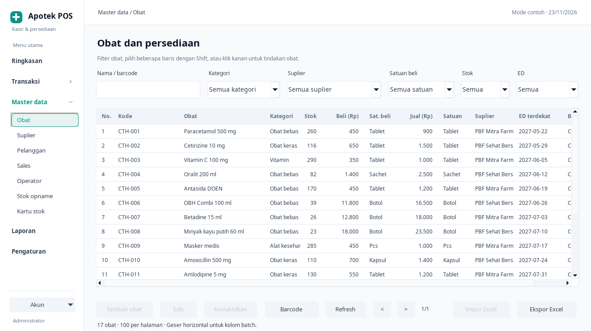
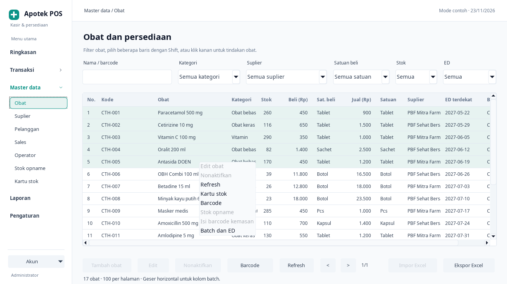

# Adaptasi referensi video ke desktop Windows

Referensi: https://www.youtube.com/watch?v=LvgDavrJEz0 — “Test Upload”, durasi 1 menit 57 detik.

Sepuluh tangkapan layar desktop iB Apotek dari pengguna juga sudah diperiksa. Rincian fitur, perbedaan dengan proyek, dan gambar aslinya tersedia dalam [pemetaan referensi desktop](ib-reference.md).

Analisis visual menggunakan storyboard per detik, dengan gambar 277 × 180 piksel. Nama modul dan alur utama dapat diidentifikasi; detail teks kecil dan aturan bisnis yang tidak diperlihatkan membutuhkan referensi tambahan jika harus sama persis.

Pilihan pengguna: mempertahankan proyek desktop Windows `kasir_apotek`, memakai tampilan bersih dan ringan, serta menggunakan LAN dan cadangan lokal.

Hasil audit fungsi POS dan perbaikan terbaru tersedia di [audit POS](pos-audit.md). Identitas pada sidebar, login, judul aplikasi, struk, dan laporan mengambil nama apotek dari Pengaturan.

## Modul yang tersedia

| Modul | Perilaku desktop |
| --- | --- |
| Dashboard | Penjualan dan laba kotor harian, penjualan bulanan, modal stok, peringatan stok, grafik penjualan, obat terlaris, pelanggan teratas. Angka berasal dari database. |
| Penjualan | Scan barcode langsung menambah satu satuan dasar; scan berulang menaikkan jumlah pada baris yang sama. Input manual langsung di atas keranjang mengatur satuan, jumlah, harga, dan diskon barang. Tanggal, faktur otomatis, pembayaran, Sales, dan pelanggan berada di atas. Baris input obat dan keranjang memakai lebar penuh. Diskon faktur, ongkos, total, bayar, kembalian, kertas 58/80 mm, serta aksi simpan/cetak/pending berada di bawah. Tunai/kredit, jatuh tempo, pending/upsert, serta pratinjau tetap tersedia. F4 menyimpan dan mencetak langsung; cetak ulang tidak membuat faktur atau mutasi stok baru. |
| Pembelian | Faktur suplier, tanggal, satuan, batch, kedaluwarsa, diskon barang/faktur, pajak yang dapat diisi, tunai/kredit, pending, dan penambahan stok. |
| Hutang dan piutang | Daftar sisa tagihan, pembayaran sebagian/penuh, dan riwayat pembayaran. |
| Obat | Tambah/edit/nonaktifkan, barcode kemasan atau kode otomatis, menu baris lengkap, tanggal ED terdekat, kolom batch, label beberapa obat, multi-satuan dan satuan beli, stok minimum, filter kategori/suplier/satuan beli/stok/ED, serta navigasi 100 obat per halaman. Impor Excel menyediakan template dan progres; membaca berkas serta penyimpanan berlangsung pada worker. |
| Master pendukung | Suplier dengan kode, kontak, email, rekening, keterangan, dan impor/ekspor Excel. Pelanggan, Sales terpisah, serta operator dan role. Password operator baru memakai bcrypt. |
| Stok opname | Penyesuaian hasil hitung fisik, alasan, dan pencatatan kartu stok. Penyesuaian mengurangi beberapa batch bila perlu. |
| Retur | Retur satu faktur utuh, pengembalian stok sesuai alokasi batch, nominal uang kembali, dan pencegahan retur ganda. |
| Laporan | Penjualan, pembelian, ringkasan harian, persediaan, kartu stok, pembayaran, retur, obat terlaris, serta pelanggan teratas. Daftar penjualan memiliki filter tambahan operator/pelanggan/pembayaran, rincian obat, dan cetak ulang struk. Laporan per barang memuat rincian faktur dan laba per kelompok; grafik bulanan memuat omzet/laba harian. Mendukung pratinjau/cetak melalui browser, tanggal, pencarian, dan ekspor Excel. |
| Pengaturan | Identitas apotek, header/footer struk, printer, kertas 58/80 mm, serta cadangan SQL. |
| LAN | Mekanisme server/client dan pencarian server yang sudah ada tetap digunakan. Sinkronisasi cloud eksternal tidak diperlukan menurut pilihan pengguna. |

Navigasi utama memakai sidebar putih. Kelompok Transaksi dan Master data dapat dibuka-tutup; hanya satu kelompok diperluas agar menu tetap ringkas. Halaman aktif ditandai warna teal lembut, lokasi halaman tersedia pada bar atas, dan menu Akun berada di bawah sidebar. Penjualan dan pembelian dibuat melalui tombol tambah pada daftar faktur, dalam jendela aplikasi yang sama. Memilih faktur menampilkan obat, jumlah, satuan, harga, potongan, subtotal, batch, dan stok dalam satuan dasar. Area konten menyesuaikan ukuran jendela tanpa mengecilkan ukuran huruf. Tampilan menggunakan widget FLTK native, dengan warna terang, ruang antarkontrol, hover, dan indikator fokus keyboard.

Dokter tidak ditampilkan pada kasir, filter/kolom laporan, maupun menu master, sesuai kebutuhan pengguna. Kolom database dan metadata pending lama tetap dipertahankan. Penjualan baru tanpa pending lama tidak menetapkan dokter.

Kasir mengikuti susunan gambar IB terbaru dari pengguna: metadata di atas, input kode/nama/jumlah/satuan/harga/diskon/total dalam satu baris, keranjang lebar, dan perhitungan serta pembayaran di bawah. Diskon dan ongkos tampil langsung. Penjualan biasa ditampilkan sebagai keterangan; tidak ada pilihan jenis penjualan lain yang belum didukung. Jatuh tempo muncul saat memilih Kredit. Tombol tambah obat aktif setelah obat dipilih; simpan aktif setelah keranjang terisi dan aplikasi terhubung. Daftar penjualan menyembunyikan filter tambahan secara default, menampilkan rincian obat lebih lega, dan menyediakan menu Cetak dan ekspor. Kolom Qty dasar menunjukkan jumlah yang dibeli dalam satuan dasar.

## Pratinjau

Dari folder proyek:

```bash
cargo run -- --preview
```

Pratinjau tidak membutuhkan MariaDB dan menampilkan data contoh yang konsisten. Penyimpanan dinonaktifkan. Jalankan aplikasi normal untuk login dan memakai database.

Saat memperbarui instalasi, jalankan versi baru pada **komputer server terlebih dahulu**, lalu perbarui dan jalankan client. Server menjalankan migrasi skema tambahan untuk satuan beli, metadata suplier, master Sales, ongkos, serta snapshot nama/kode obat. Migrasi tidak mengisi ulang data contoh maupun menimpa pengaturan pada setiap pembukaan aplikasi.


Susunan kasir telah diperbarui mengikuti gambar IB. Screenshot kasir lama di folder `screenshots` merupakan arsip susunan sebelumnya; gambar terbaru menunggu pemeriksaan GUI yang masih tertahan oleh automatic approval review.




## Pemeriksaan

- Build Linux offline dan sepuluh uji unit lulus; satu uji database dijalankan terpisah. Uji GUI dari susunan sebelumnya pernah lulus. Kasir dengan susunan IB terbaru dan pemeriksaan tambahan untuk filter pembayaran/cetak belum diuji ulang karena penolakan automatic approval review pada eksekusi Xvfb.
- Ekspor lalu impor master Excel mempertahankan barcode dengan nol di awal dan harga desimal.
- Uji MariaDB terisolasi lulus untuk upgrade skema lama, migrasi berulang, login/password, FEFO, stok tidak cukup, batch kedaluwarsa, kredit, pembayaran, pending lama, retur, stok opname lintas batch, impor atomik, dan cadangan SQL. Penyesuaian IB juga diuji untuk tanggal/Sales/dokter/ongkos, diskon faktur, laba, faktur tersimpan, filter, 205 obat dalam tiga halaman, dan nonaktifkan beberapa obat. Alur pending diuji untuk klik berulang dan enam penyimpanan bersamaan, pembaruan draf, pending sebelum pembayaran, serta pembersihan pending saat checkout. Simulasi printer gagal dan cetak ulang memverifikasi satu faktur dan satu pengurangan stok.
- Cadangan SQL dipulihkan ke database uji kosong; pengaturan dan transaksi terverifikasi.
- Pratinjau pada layar virtual 1366 × 768 dapat membuka navigasi utama. Pengukuran RSS pratinjau Linux sekitar 37 MiB setelah membuka beberapa modul dan data contoh; pemakaian Windows perlu diukur pada perangkat target.
- Uji tabel stok opname memastikan header, kolom lain, dan scrollbar tetap terlihat setelah memilih sel dan menggulir tabel. Uji GUI kasir mencakup input langsung, scan berulang, total/kembalian, pilihan beberapa baris, jumlah label, menu baris, struk, dan grafik.
- Navigasi sidebar, perpindahan halaman, penanda halaman aktif pada formulir baru/kembali ke daftar, serta penyesuaian konten dashboard dan tabel diperiksa pada layar virtual. Sidebar memakai menu yang lebih rapat ketika tinggi layar lebih kecil agar menu Akun tetap terpisah.

```bash
cargo test --offline
```

Uji tampilan tabel menjalankan pratinjau tanpa database. Di Linux, sediakan Xvfb, ImageMagick (`import` dan `magick`), serta pustaka X11/Xtst:

```bash
cargo build --offline
xvfb-run -a -s '-screen 0 1366x768x24' python3 tests/table_redraw.py
```

Uji sidebar memeriksa menu yang dibuka-tutup, penanda halaman aktif, kembali ke daftar penjualan, seluruh halaman, dan akun pada layar lebih pendek:

```bash
xvfb-run -a -s '-screen 0 1366x720x24' python3 tests/sidebar_layout.py
```

Uji database membuat MariaDB sementara dengan socket di `/tmp/apotek-test-db-*`, tanpa koneksi TCP. Sediakan `mariadb-install-db`, `mariadbd`, dan utilitas cadangan MariaDB:

```bash
python3 tests/database_workflow.py
```

Jika MariaDB uji sementara sudah berjalan, uji Rust dapat dijalankan langsung dengan socket tersebut:

```bash
APOTEK_TEST_SOCKET=/tmp/apotek-test-db-XXXX/mysql.sock cargo test --offline database_transaction_workflow -- --ignored
```

## Batas yang perlu diketahui

Retur saat ini berlaku untuk satu faktur utuh. Retur sebagian membutuhkan aturan dan UI per item. Master obat memakai navigasi 100 obat per halaman; pilihan obat di kasir dan antrean barcode dibatasi 200 hasil pencarian. Laporan per barang menampilkan paling banyak 10.000 rincian; laporan lainnya 500 baris per filter. Persempit pencarian atau periode untuk data lainnya.

Impor obat menambahkan master baru secara atomik, termasuk satuan beli dan konversi. Kolom harga beli/jual memakai harga per satuan dasar. Relasi suplier dan stok/batch historis belum dipulihkan oleh impor obat. Struktur file impor iB tidak terlihat dalam gambar; template proyek ini tidak mengklaim kompatibilitas langsung dengan file iB.

Rincian Biaya/Cashflow, `Nhari`, jenis penjualan selain `Biasa`, dan aturan penghapusan transaksi belum diketahui dari referensi. Perilaku tersebut belum ditambahkan.

Build dan pengujian perangkat Windows, kompatibilitas Windows 7/32-bit, printer thermal nyata, dan koneksi dua PC LAN masih membutuhkan perangkat target. Pemeriksaan ini menggunakan Linux dan MariaDB lokal yang terisolasi.

## Data contoh

Pengisian contoh dijalankan secara eksplisit pada komputer server:

```bash
cargo run -- --seed-demo
```

Dataset menambahkan 17 obat, 2 suplier, 4 pelanggan, 1 dokter, 9 penjualan, 3 pembelian, pembayaran kredit, 1 retur, dan transaksi pending. Kode obat dan faktur contoh memakai awalan `CTH-`. Data yang sudah ada dipertahankan; perintah dapat diulang tanpa menggandakan dataset.

Penjualan contoh memakai proses FEFO yang sama dengan penjualan biasa. Stok berkurang sesuai konversi satuan ketika faktur disimpan. Pembelian menambah stok dan retur mengembalikan stok sesuai batch. Sebagai contoh, 2 Strip dengan isi 10 Tablet mencatat keluar 20 Tablet.

## Barcode obat dan label

1. Buka **Master data → Obat → Tambah obat**. Isi atau scan barcode kemasan ke kolom **Kode / barcode**.
2. Jika kemasan tidak memiliki barcode, biarkan kolom kosong lalu pilih **Buat barcode**. Kode numerik dibuat oleh server database bersama dan diperiksa terhadap kode yang sudah digunakan. Simpan obat untuk menyimpan kode tersebut.
3. Klik kanan baris obat, lalu pilih **Isi barcode kemasan** untuk menyimpan barcode pabrikan. Pilih **Barcode** untuk membuat label dari kode tersimpan. Gunakan Shift untuk memilih beberapa baris sebelum membuka antrean barcode; tombol **Barcode** di bawah tabel juga tersedia.
4. Di antrean barcode, tambah/cari obat, pilih ukuran label dan DPI sesuai printer, lalu pilih baris dan isi **Label per obat**. **Terapkan jumlah** mengubah jumlah label pada semua baris yang dipilih. **Hapus** membuang pilihan; **Reset** mengosongkan antrean. Batasnya 200 obat dan 1.000 label per dokumen. **Pratinjau** dan **Cetak label** membuka HTML di browser; gunakan skala 100% / ukuran sebenarnya. **Simpan label** menyimpan HTML untuk dicetak kembali.
5. Atur scanner USB ke mode keyboard (HID), aktifkan Code 128, dan gunakan akhiran Enter. Di penjualan baru, **F1** memfokuskan kolom kode. Barcode yang cocok langsung menambahkan **1 satuan dasar**, memakai nama, satuan, dan harga dari master obat. Scan berulang menambah jumlah pada baris yang sama. Kolom dikosongkan dan fokus kembali untuk scan berikutnya. Untuk input manual, cari nama di kolom kode, pilih obat, lalu atur jumlah, satuan, harga, dan diskon di baris atas keranjang sebelum memilih **Tambah**.

Kode obat yang sudah tersimpan juga dapat dicetak menjadi barcode; tidak perlu mengganti kode tersebut. Kolom **Kode / barcode** menyimpan satu kode untuk satu obat. Pencarian memprioritaskan kecocokan kode lengkap sebelum hasil nama atau potongan kode. Stok berkurang ketika penjualan disimpan, bukan ketika barcode dipindai.

Alur F3/F4/F6/F7, pengulangan cetak, dan penanganan pending lama dijelaskan pada [alur pending dan cetak](ib-reference.md#alur-pending-dan-cetak). Semua PC LAN perlu memakai versi baru agar client lama tidak terus menambahkan pending duplikat.

Form penjualan memakai obat dan batch yang sudah tersimpan; tidak meminta nomor batch maupun input ED. Batch dan ED tetap dicatat pada pembelian barang masuk. Shortcut hanya berlaku pada halaman yang terlihat. Keranjang memeriksa jumlah seluruh satuan obat terhadap stok yang masih layak jual; batch kedaluwarsa tidak dapat dipakai.

Tabel obat menampilkan **ED terdekat** dari batch yang masih memiliki stok. Klik kanan **Batch dan ED** untuk melihat semua batch yang masih memiliki stok beserta tanggal ED, jumlah, dan harga beli. Obat tanpa tanggal ED ditampilkan dengan tanda `—`.



Label memuat nama obat, harga, kode, dan Code 128 dengan checksum serta ruang putih pada kedua sisi. Bagian numerik memakai set C bila lebih ringkas, termasuk dalam kode campuran huruf/angka. Nol di depan dipertahankan. Kode 1–50 karakter ASCII cetak dapat dibuatkan label.

Pilihan label: 30 × 20, 40 × 25, atau 50 × 30 mm dengan tiga kolom; 58 × 30 atau 80 × 40 mm dengan satu kolom; serta ukuran otomatis. Default 50 × 30 mm pada 203 dpi. Printer 300 dpi dapat mendukung barcode yang lebih rapat pada label kecil. Ukuran ditolak bila lebar batang kurang dari dua titik printer atau 0,19 mm. Pilih ukuran lebih besar jika kode tidak muat. Ukuran kertas harus memuat seluruh kolom; tiga kolom label 50 mm memerlukan lembar lebih lebar daripada printer thermal 58/80 mm.


Uji barcode Linux dengan pembaca independen membutuhkan `rustc`, `rsvg-convert`, dan `zbarimg`:

```bash
python3 tests/barcode_decode.py
```

Sebelas kode terverifikasi dengan pembaca independen, termasuk numerik, nol di depan, huruf, tanda baca, dan campuran angka panjang. Tiga kombinasi label juga terverifikasi: 30 × 20 dan 40 × 25 mm pada 300 dpi, serta 50 × 30 mm pada 203 dpi. Uji database mencakup kode otomatis berbeda, penyimpanan, penolakan duplikasi, penggantian kode, dan prioritas kecocokan penuh. Uji GUI memeriksa pilihan lima obat, lima label awal, lalu tujuh label setelah jumlah dua obat diubah menjadi dua. Scanner dan printer label fisik Windows masih perlu diuji pada perangkat target.

Uji alur penjualan membuka pembelian lebih dahulu untuk memeriksa shortcut pada halaman yang terlihat, lalu memeriksa scan langsung/berulang, barcode tidak ditemukan, input manual tanpa dialog ED, diskon 10% dan ongkos, pratinjau struk, ED pada tabel, pilihan beberapa baris, antrean barcode, kartu stok, batch/ED, cetak ulang faktur, dan grafik bulanan:

```bash
cargo build --offline
xvfb-run -a -s '-screen 0 1366x768x24' python3 tests/pos_workflow.py
```
